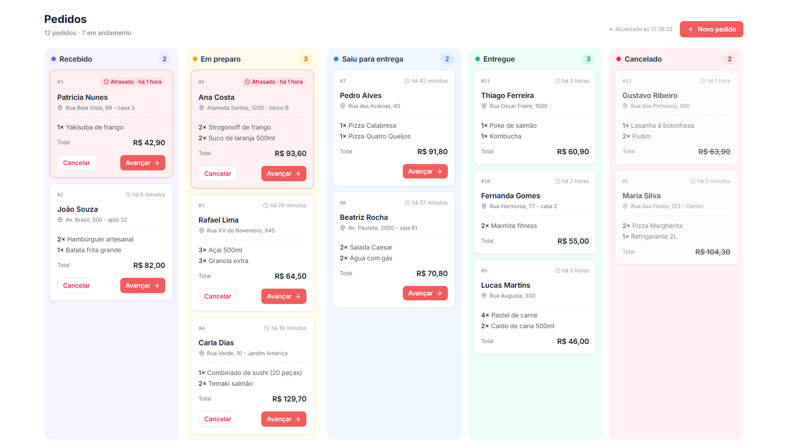
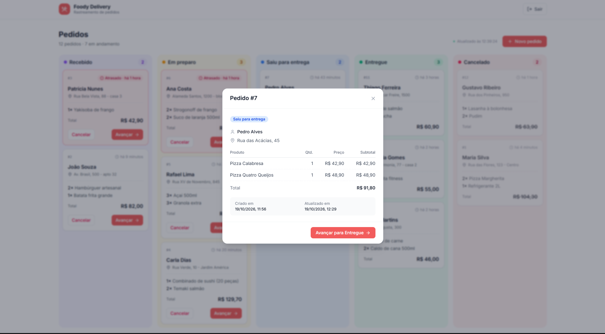

# Foody — Mini Rastreador de Pedidos

Sistema simplificado de rastreamento de pedidos de delivery, desenvolvido como desafio técnico para a vaga de Desenvolvedor Full-Stack Pleno da Foody Delivery.

- **Back-end:** API REST em Java 21 + Spring Boot 4, com autenticação JWT e persistência em SQLite.
- **Front-end:** React 19 + TypeScript + Tailwind CSS, com um painel de pedidos por status.

### Painel de pedidos



### Detalhe do pedido



## Funcionalidades

- Cadastro de usuário (nome, e-mail e senha) e login com e-mail e senha.
- Acesso ao sistema apenas para usuários autenticados (token JWT).
- Criação de pedidos com cliente, endereço de entrega e itens.
- Painel com os pedidos organizados em colunas por status, com atualização automática a cada 10 segundos e alerta sonoro quando chega um pedido novo.
- Avanço do status passo a passo e cancelamento, ambos com confirmação.
- Detalhe do pedido (busca por ID), com itens, subtotais, total e datas.
- Destaque para pedidos atrasados: mais de 1 hora desde a criação sem terem sido entregues.

## Tecnologias

| Camada | Tecnologias |
|---|---|
| Front-end | React 19, TypeScript, Tailwind|
| Back-end | Java 21, Spring Boot 4, Spring Security com JWT |
| Banco de dados | SQLite, com migrations do Flyway |

## Como rodar

### Pré-requisitos

- Java 21
- Node.js 22 ou superior

O Maven não precisa estar instalado: o projeto usa o Maven Wrapper (`mvnw`).

### 1. Clonar o repositório

```bash
git clone https://github.com/fredrbo/foody-order-tracker.git
cd foody-order-tracker
```

### 2. Back-end

```bash
cd backend

# com dados de demonstração (recomendado para avaliar)
./mvnw spring-boot:run -Dspring-boot.run.profiles=demo

# ou com o banco vazio
./mvnw spring-boot:run
```

No Windows (PowerShell ou CMD), use `.\mvnw` e coloque o argumento entre aspas: `.\mvnw spring-boot:run "-Dspring-boot.run.profiles=demo"`.

A API sobe em `http://localhost:8080`. O banco é criado automaticamente em `backend/data/foody.db`, e as tabelas são criadas pelo Flyway.

#### Dados de demonstração

O perfil `demo` popula o banco **no momento em que ele é criado**, com:

- **Usuário:** `demo@foody.com`
- **Senha:** `foody123`
- **12 pedidos** distribuídos em todos os status, incluindo pedidos atrasados. Os horários são relativos ao momento em que o banco foi criado.

Os dados são inseridos uma única vez: rodar de novo com o perfil `demo` não duplica nem atualiza os pedidos. Para recriá-los, com os horários atualizados, pare a API, apague o arquivo `backend/data/foody.db` e suba de novo com o perfil `demo`.

### 3. Front-end

```bash
cd frontend
npm install
npm run dev
```

Acesse `http://localhost:5173` e entre com o usuário de demonstração, ou crie uma conta na tela de cadastro.

### 4. Testes

```bash
cd backend
./mvnw test
```

O relatório de cobertura do JaCoCo é gerado em `backend/target/site/jacoco/index.html`.

## Variáveis de ambiente

Todas têm valor padrão para desenvolvimento, então nenhuma é obrigatória para rodar localmente.

**Back-end**

| Variável | Padrão | Descrição |
|---|---|---|
| `DB_PATH` | `./data/foody.db` | Caminho do arquivo do SQLite |
| `JWT_SECRET` | segredo de desenvolvimento | Chave de assinatura do JWT (mínimo de 32 caracteres). **Deve ser trocada em produção** |
| `JWT_EXPIRATION` | `2h` | Validade do token |
| `CORS_ALLOWED_ORIGINS` | `http://localhost:5173` | Origens autorizadas a chamar a API |
| `SERVER_PORT` | `8080` | Porta da API |

**Front-end** (veja `frontend/.env.example`)

| Variável | Padrão | Descrição |
|---|---|---|
| `VITE_API_URL` | `http://localhost:8080` | URL da API |

## API

Documentação interativa (Swagger): **http://localhost:8080/swagger-ui.html**

| Método | Rota | Autenticação | Descrição |
|---|---|---|---|
| `POST` | `/api/users` | pública | Cadastra um usuário |
| `POST` | `/api/auth/login` | pública | Faz login e devolve o token JWT (usado para autenticar as demais rotas) |
| `POST` | `/api/orders` | JWT | Cria um pedido (status inicial `RECEBIDO`) |
| `GET` | `/api/orders` | JWT | Lista todos os pedidos, do mais recente para o mais antigo |
| `GET` | `/api/orders/{id}` | JWT | Busca um pedido pelo ID |
| `PATCH` | `/api/orders/{id}/status` | JWT | Atualiza o status do pedido |

Nas rotas protegidas, envie o header `Authorization: Bearer <token>`.

## Estrutura do projeto

```
backend/
  src/main/java/com/foody/ordertracker/
    config/        segurança, CORS, OpenAPI, BCrypt
    controller/    endpoints REST
    dto/           objetos de requisição e resposta
    exception/     exceções de negócio e tratamento global de erros
    model/         entidades JPA e enum de status
    repository/    repositórios Spring Data
    security/      filtro de autenticação JWT
    service/       regras de negócio
  src/main/resources/
    db/migration/  migrations do Flyway (estrutura do banco)
    db/seed/       dados de demonstração (perfil demo)
frontend/
  src/
    api/           chamadas à API
    components/    componentes de tela (pedidos, formulários, modais, toasts)
    constants/     configuração dos status
    hooks/         useOrders (carregamento e polling)
    pages/         telas de login/cadastro e de pedidos
    utils/         formatação, validação e som de notificação
```

## Uso de IA

O desafio permite o uso de IA, e este projeto foi desenvolvido com o **Claude Code** como assistente de programação, de forma iterativa: uma funcionalidade por vez, com revisão e explicação de cada arquivo antes de seguir.

**Feito com a IA:**

- Geração da estrutura inicial do back-end e do front-end e de boa parte do código, a partir das minhas instruções.
- Explicação de conceitos e alternativas antes de cada implementação: formas de autenticação, JWT, `@EnumeratedValue`, testes unitários com Mockito, JaCoCo, banco isolado para testes.
- Escrita dos testes unitários e investigação de erros durante o desenvolvimento: configuração do SQLite com o Hibernate, CORS, validação de migrations do Flyway.

